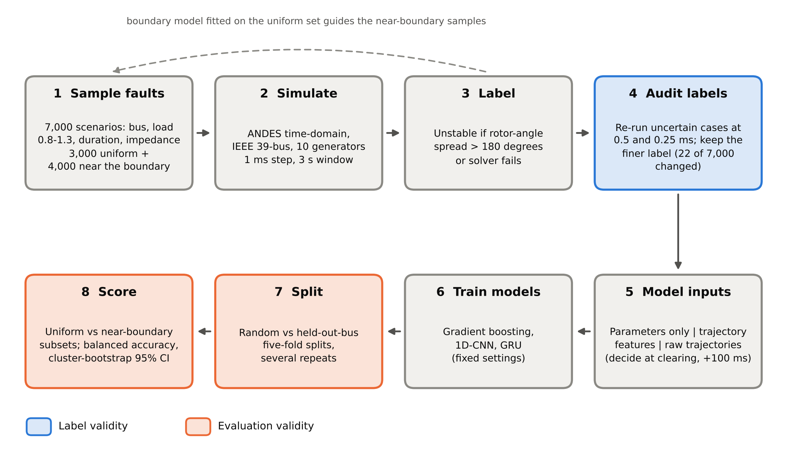
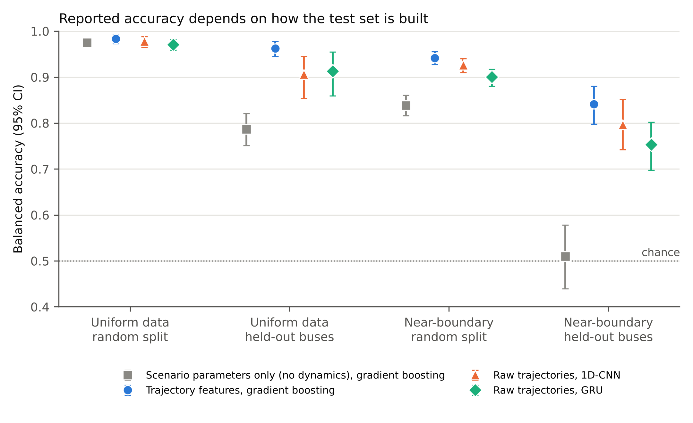

# Label and Evaluation Validity in Machine-Learning Transient Stability Assessment: A Case Study on the IEEE 39-Bus System

Code, scenario tables and results for a study of how much reported accuracy in ML-based transient stability assessment (TSA) survives two checks: whether the labels are correct, and whether the test set resembles the cases that matter. Time-domain simulations come from [ANDES](https://github.com/CURENT/andes) 2.0.0.

**Author:** Mir Ishfak Faisal Rafi (Power Grid Bangladesh PLC; Bangladesh University of Engineering and Technology (BUET), Dhaka, Bangladesh)

**Status:** work in progress; a preprint is in preparation. Results below are from the current dataset and may change before the preprint.



## Question

Published ML-TSA studies report very high accuracy on randomly split simulated cases (for example over 98% in Gomez et al., 2011, and 99.97% in Yu et al., 2018). We ask how much of that survives two checks:

1. **Label validity.** Are the stable/unstable labels reliable? Labels come from a numerical simulation, so the time step and fault impedance can flip them.
2. **Evaluation validity.** Does the accuracy hold when the test set is not a random sample of the same scenarios, for example at buses the model never saw, or for scenarios near the stability boundary?

## Data

7,000 fault scenarios on the IEEE 39-bus case (`ieee39/ieee39_full.xlsx` shipped with ANDES): three-phase fault at t = 1.0 s on a bus, load scaling 0.8-1.3, fault duration 0.05-0.40 s, fault impedance xf 1e-3 to 1e-2 (log-uniform; per-unit base not verified), 1 ms step, 3 s window.

| Set | Scenarios | Sampling |
|---|---|---|
| Night 1 (`data/night1`) | 3,000 | uniform over the parameter ranges |
| Night 2 (`data/night2`) | 4,000 | concentrated near each bus's estimated stability boundary (`src/boundary.json`) |

A run is labelled unstable if the rotor-angle spread exceeds 180 degrees or the solver fails. Solver-failure labels and low-impedance cases were re-simulated at 0.5 ms (and 0.25 ms) and the finer-step label is used where available.

The boundary model is a logistic regression fitted on the night-1 data. Its coefficients are released in `src/boundary.json` (used for sampling night 2 and for the near-boundary subset). `src/fit_boundary.py` refits it and approximately reproduces the released coefficients (probability correlation 0.9999); the exact original fitting script was not kept.

The rotor angle and speed trajectories (about 40 MB per night) are not in this repository; they are archived on Zenodo (link to be added). Unzip them into `data/night1/traj/` and `data/night2/traj/`.

## Main findings (current data)

Balanced accuracy, trajectory models decide 100 ms after fault clearing (95% cluster-bootstrap intervals in `results/`):

| Test design | Parameters only | Gradient boosting | 1D-CNN | GRU |
|---|---|---|---|---|
| Uniform data, random split | 0.975 | 0.984 | 0.978 | 0.971 |
| Uniform data, held-out buses | 0.787 | 0.963 | 0.906 | 0.913 |
| Near-boundary, random split | 0.839 | 0.941 | 0.926 | 0.900 |
| Near-boundary, held-out buses | 0.510 | 0.841 | 0.797 | 0.753 |



- **Labels.** Of 74 solver-failure labels at 1 ms, 20 (27%) turned out stable at a finer step. Angle-separation labels are mostly reliable: of 402 low-impedance cases rechecked at 0.5 ms, 2 flipped. In total 22 of 7,000 labels changed.
- **A model with no dynamics matches the usual benchmark.** A model that sees only scenario parameters and bus identity scores 0.975 on a random split of the uniform data, close to the trajectory models (0.971-0.984).
- **It collapses where it matters.** On near-boundary scenarios at unseen buses the parameters-only model is at chance (AUC 0.50), and the trajectory models lose 14-22 points compared with the uniform random split.
- **More flexible models do not close the gap** at this data size (about 6,400 scenarios); the CNN and GRU are small and untuned.
- **Earlier decisions are harder.** Deciding at clearing instead of 100 ms later lowers near-boundary held-out-bus balanced accuracy from 0.841 to 0.763 (gradient boosting).

## Repository layout

```
src/        scenario generator, boundary model (boundary.json, fit_boundary.py), repair and rerun scripts
analysis/   feature extraction, evaluation (gradient boosting, neural networks), figure scripts
data/       scenario tables (results.csv, rerun files); trajectories are not included
results/    evaluation output tables
figures/    figures (PNG and PDF) with their data tables
```

## Reproduce

```
conda env create -f environment.yml
conda activate andes39

# 1. generate scenarios (hours; resumable)
python src/gen_dataset.py --out data_v3 --boundary src/boundary.json

# 2. re-simulate uncertain labels at finer steps
python src/rerun_failures.py data_v3 --workers 4

# 3. refit the boundary model (compare with src/boundary.json)
python src/fit_boundary.py

# 4. evaluation (needs the trajectory files in data/*/traj)
python analysis/eval1.py
python analysis/eval2.py

# 5. neural networks (needs PyTorch; run from the repository root)
python analysis/nn_eval.py --models cnn gru

# 6. figures
python analysis/make_figures.py
```

Notes: night 1 was generated with an earlier version of the generator (uniform sampling, no boundary model); see the preprint for details. Generation time depends on the machine (night 1 took about 4.5 hours on an office Windows PC). `nn_eval.py` also contains a small Transformer encoder that was not evaluated for the results above.

## Limitations

One system, one simulator, finite fault impedance (not a bolted fault), a 3 s first-swing window, a 180-degree separation criterion, constant-impedance loads, and no line-trip clearing. The near-boundary subset is defined by the logistic boundary model above. The uniform set's low-impedance angle-separation labels and critical clearing times at the finer step were not rechecked, so some label noise may remain. The neural networks are small, untuned and repeated only once or twice.

## Citation

If you use this code or data, please cite the preprint (link to be added) and the ANDES paper: H. Cui, F. Li and K. Tomsovic, "Hybrid Symbolic-Numeric Framework for Power System Modeling and Analysis," IEEE Trans. Power Systems, vol. 36, no. 2, pp. 1373-1384, 2021.

## License

MIT
