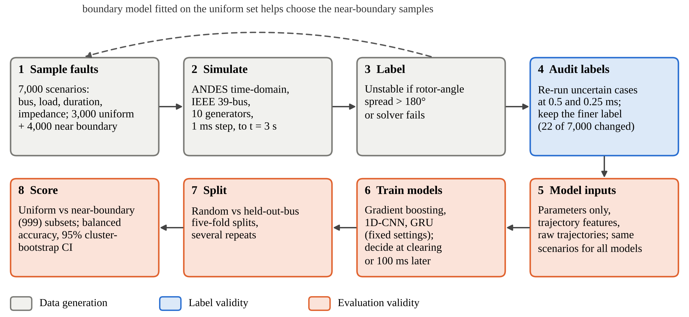
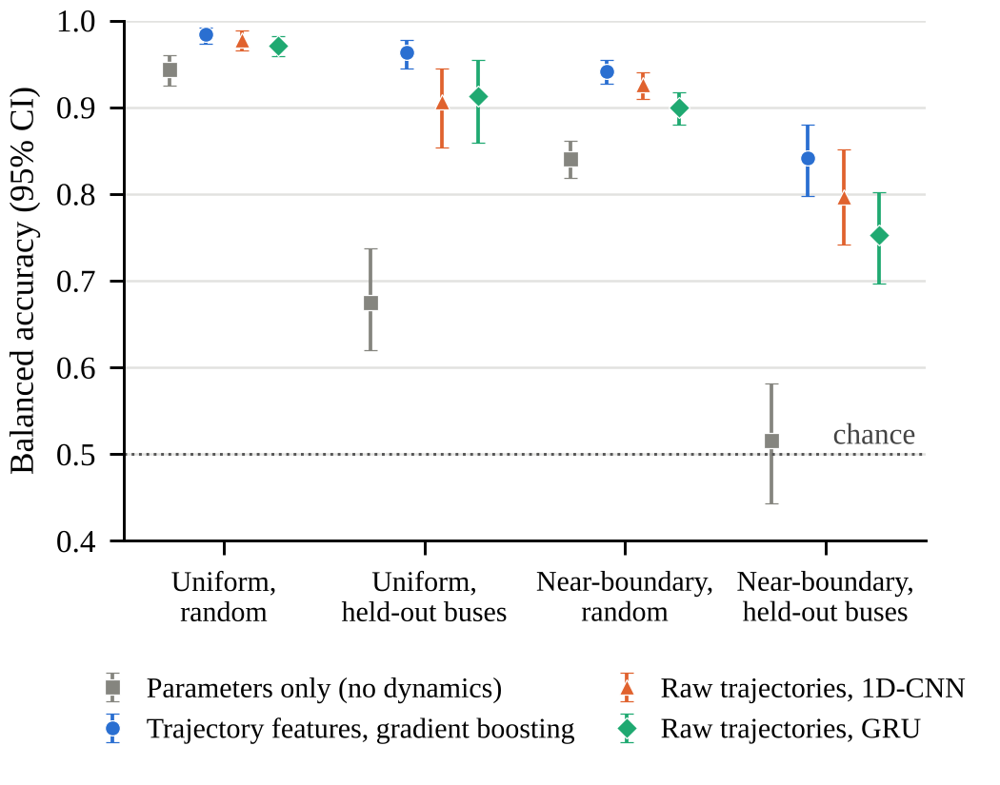

# Label and Evaluation Validity in ML Transient Stability Assessment

Code and data tables for a case study on the IEEE 39-bus system. It asks how much of the high accuracy reported by machine-learning transient stability models survives two checks: are the labels correct, and does the test set look like the cases that matter? Simulations use [ANDES](https://github.com/CURENT/andes) 2.0.0.

**Author:** Mir Ishfak Faisal Rafi, Power Grid Bangladesh PLC, Dhaka, Bangladesh
**Paper (latest version):** [doi:10.5281/zenodo.23337822](https://doi.org/10.5281/zenodo.23337822)
**Trajectory data:** [doi:10.5281/zenodo.23336324](https://doi.org/10.5281/zenodo.23336324)
**License:** MIT



## Main findings

Balanced accuracy; trajectory models decide 100 ms after fault clearing.

| Test design | Parameters only | Gradient boosting | 1D-CNN | GRU |
|---|---|---|---|---|
| Uniform data, random split | 0.944 | 0.984 | 0.978 | 0.971 |
| Uniform data, held-out buses | 0.675 | 0.963 | 0.906 | 0.913 |
| Near-boundary, random split | 0.840 | 0.941 | 0.926 | 0.900 |
| Near-boundary, held-out buses | 0.516 | 0.841 | 0.797 | 0.753 |



- **Labels:** 20 of 74 (27%) solver-failure "unstable" labels were stable at a finer time step. Of 402 angle-separation labels rechecked, 2 flipped. In total, 22 of 7,000 labels changed.
- **A model with no dynamics comes close:** parameters and bus identity alone give 0.944 on a random split, within 3 to 4 points of the trajectory models.
- **It fails where it matters:** on near-boundary faults at unseen buses it drops to chance (0.52), and the trajectory models lose 14 to 22 points.
- **Deciding earlier is harder:** at fault clearing instead of 100 ms later, near-boundary held-out-bus accuracy drops from 0.841 to 0.763 (gradient boosting).

## Data

7,000 three-phase fault scenarios on the IEEE 39-bus case, simulated up to 3 s at a 1 ms step.

| Set | Scenarios | Sampling |
|---|---|---|
| Night 1 (`data/night1`) | 3,000 | uniform over the parameter ranges |
| Night 2 (`data/night2`) | 4,000 | near each bus's estimated stability boundary (`src/boundary.json`) |

A run is unstable if the rotor-angle spread exceeds 180 degrees or the solver fails. Uncertain labels were re-simulated at 0.5 ms (and 0.25 ms), and the finer-step label is used. The trajectories (about 40 MB per night) are on Zenodo; unzip them into `data/night1/traj/` and `data/night2/traj/`.

## Repository layout

```
src/        scenario generator, boundary model, rerun scripts
analysis/   feature extraction, evaluation, figure scripts
data/       scenario tables and rerun files (no trajectories)
results/    evaluation tables
figures/    figures
```

## Reproduce

```
conda env create -f environment.yml
conda activate andes39

python src/gen_dataset.py --out data_v3 --boundary src/boundary.json   # generate scenarios (hours)
python src/rerun_failures.py data_v3 --workers 4                       # re-simulate uncertain labels
python src/fit_boundary.py                                             # refit boundary model
python analysis/eval1.py                                               # evaluation
python analysis/eval2.py
python analysis/nn_eval.py --models cnn gru                            # neural networks (PyTorch)
python analysis/make_figures.py                                        # figures
```

Night 1 was generated with an earlier version of the generator (uniform sampling, no boundary model). `src/fit_boundary.py` approximately reproduces the released boundary coefficients.

## Limitations

One system and one simulator; finite fault impedance (not bolted); a 3 s first-swing window; constant-impedance loads; no line-trip clearing. The neural networks are small and untuned. Some label noise may remain in the uniform set's low-impedance cases.

## Citation

Please cite the paper ([doi:10.5281/zenodo.23337822](https://doi.org/10.5281/zenodo.23337822)) and the ANDES paper: H. Cui, F. Li and K. Tomsovic, "Hybrid Symbolic-Numeric Framework for Power System Modeling and Analysis," *IEEE Trans. Power Systems*, vol. 36, no. 2, pp. 1373-1384, 2021.
